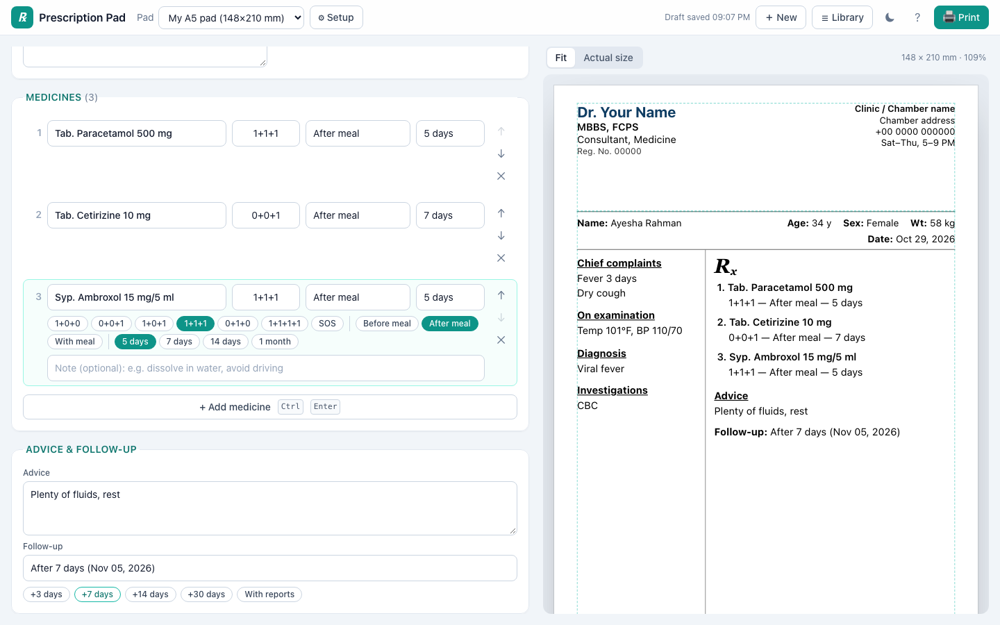
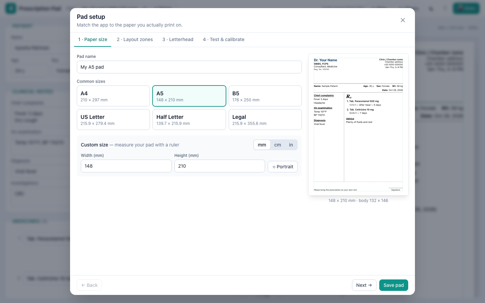
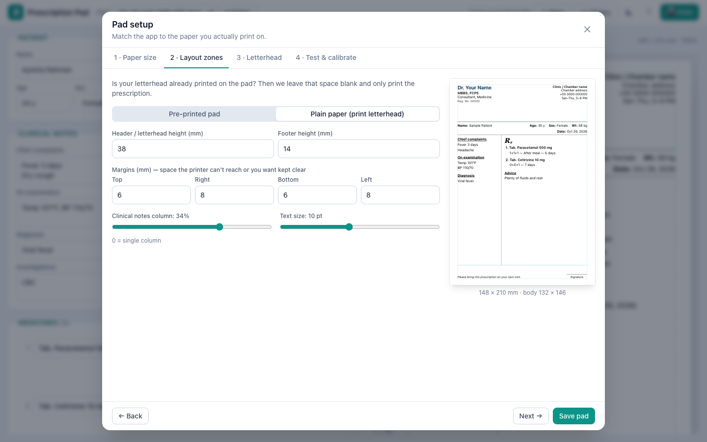
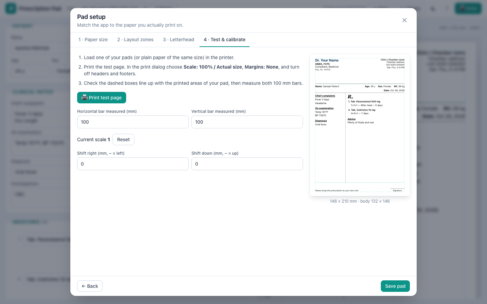
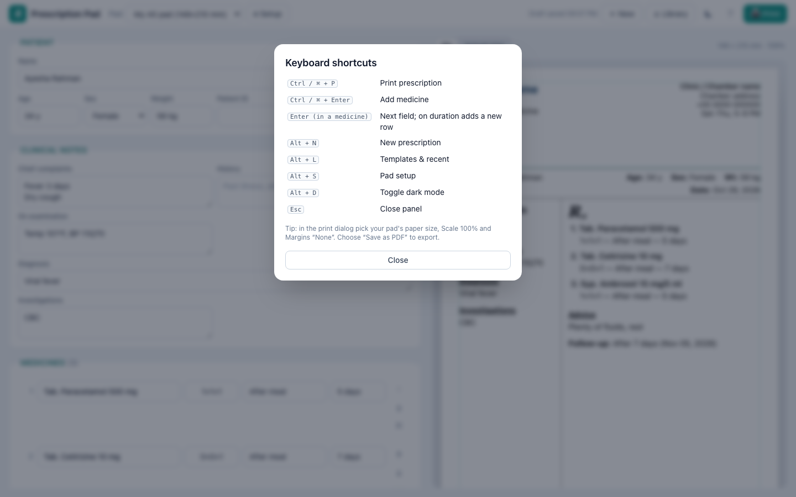

# Prescription Pad (dynamic-prescription)

**Write a prescription in under a minute and print it exactly onto your own pad.**

[](https://dynamic-prescription.vercel.app)
[](https://github.com/junaaid96/dynamic-prescription/actions/workflows/ci.yml)
[](LICENSE)

Prescription Pad is a free, open-source, local-first web app for doctors who write on their **own printed pads**. Some pads have the chamber letterhead already printed, others are plain paper, and they come in many sizes. You describe the pad once (size, header/footer zones, margins), calibrate it with a 100 mm test print, and from then on every prescription lands in the right place on the paper.

There is no backend and no account. Pads, drafts, templates and history are stored in the browser's `localStorage`, so **patient data never leaves the device**.

> Live demo: **https://dynamic-prescription.vercel.app** (all names in the screenshots are demo data)



## Features

**Pad setup wizard**
- Paper presets (A4, A5, B5, US Letter, Half Letter, Legal) or a custom size in mm, cm or inches, portrait or landscape.
- Pre-printed letterhead (leave the header blank) or plain paper (print your own letterhead).
- Header/footer heights, margins, clinical-notes column width and text size, with a live to-scale preview.
- **Calibration print:** print 100 mm bars, measure them and enter the result; the app stores a scale factor plus X/Y offsets.
- Several pad profiles (for example "Chamber A5" and "Hospital A4"), switched from the toolbar.

**Fast writing**
- Patient line, chief complaints, history, examination, diagnosis and investigations, laid out like a standard South Asian prescription with a ℞ column.
- Drug autocomplete with **learned usual doses**: a drug you have used before fills in its last dose, timing and duration.
- One-tap chips for doses (`1+0+1`, `0+0+1`, SOS…), timing (before/after meal) and duration.
- Enter moves to the next field; Enter on the last field adds a new medicine.
- Follow-up chips (+3 / +7 / +14 / +30 days, with reports).

**Review, print and reuse**
- The preview always shows the real page at the pad's exact size.
- Overflow warning with one-click "shrink text".
- Prints with an exact `@page` size; save as PDF from the print dialog.
- Templates (order sets) and recent prescriptions, repeated in one click.
- Draft auto-saved; keyboard shortcuts (`?` lists them); works on phones and tablets with Write/Preview tabs.

## Screenshots

| Pad setup: paper size | Pad setup: layout zones |
| --- | --- |
|  |  |
| **Calibration print** | **Keyboard shortcuts** |
|  |  |

## Tech stack

- **Angular 22** with standalone components, signals and zoneless change detection
- **TypeScript** (strict)
- **Tailwind CSS 3**
- **Vitest** through the Angular test builder (`ng test`)
- CSS `@page` printing, millimetre-based layout
- Deployed on **Vercel** as a static site

The initial bundle is about 231 kB. There are no runtime dependencies beyond Angular and RxJS.

## Getting started

Requirements: **Node.js 22.22+ or 24.15+** and npm 10.

```bash
git clone https://github.com/junaaid96/dynamic-prescription.git
cd dynamic-prescription
npm ci
npm start          # http://localhost:4200
```

### Environment variables

None. The app is fully client-side and needs no API keys, database or `.env` file.

### Scripts

| Command | What it does |
| --- | --- |
| `npm start` | Dev server at `http://localhost:4200` |
| `npm run build` | Production build into `dist/` |
| `npm run watch` | Development build in watch mode |
| `npm test` | Unit tests (Vitest) |

### Deploy

Any static host works. On Vercel, import the repo; the Angular preset builds with `npm run build` and serves `dist/dynamic-prescription/browser`.

## Project structure

```
src/app/
├── core/                  # models, stores and pure helpers (with tests)
│   ├── pad.model.ts       # pad profile: size, zones, margins, calibration
│   ├── rx.model.ts        # prescription, patient and medicine models
│   ├── pad.store.ts       # pad profiles (signals + localStorage)
│   ├── rx.store.ts        # draft, templates, history, learned doses
│   ├── storage.ts         # localStorage wrapper
│   ├── print.service.ts   # @page sizing and printing
│   └── units.ts           # mm ⇄ cm ⇄ in
├── features/
│   ├── editor/            # patient, notes, medicines, advice, follow-up
│   ├── preview/ sheet/    # to-scale page preview and printed sheet
│   ├── pad-setup/         # 4-step setup + calibration wizard
│   └── library/           # templates and recent prescriptions
docs/DESIGN.md             # research, personas and design decisions
```

## Printing tips

1. In the print dialog choose your pad's paper size, **Scale 100% / Actual size** and **Margins: None**.
2. Turn off browser headers and footers.
3. If the output is slightly off, run the calibration step again (Setup → Test & calibrate).

## Keyboard shortcuts

| Keys | Action |
| --- | --- |
| `Ctrl/⌘ + P` | Print |
| `Ctrl/⌘ + Enter` | Add medicine |
| `Enter` (in a medicine) | Next field; on duration adds a new row |
| `Alt + N` | New prescription |
| `Alt + L` | Templates & recent |
| `Alt + S` | Pad setup |
| `Esc` | Close panel |

## Privacy

Everything stays in your browser's `localStorage`. Clearing site data removes it. This app is a writing and printing aid, not a medical record system, and it does not check drug interactions.

## Roadmap

See [docs/DESIGN.md](docs/DESIGN.md#next-ideas): a drug database with generic/brand mapping, Bangla output, export/import of pad profiles, PDF export and signature placement.

## Contributing

Contributions are welcome. Read [CONTRIBUTING.md](CONTRIBUTING.md) and the [Code of Conduct](CODE_OF_CONDUCT.md), then open an issue or pull request.

## License

[MIT](LICENSE) © Md. Junaidul Islam
